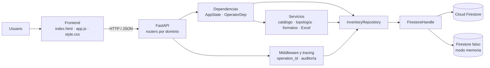
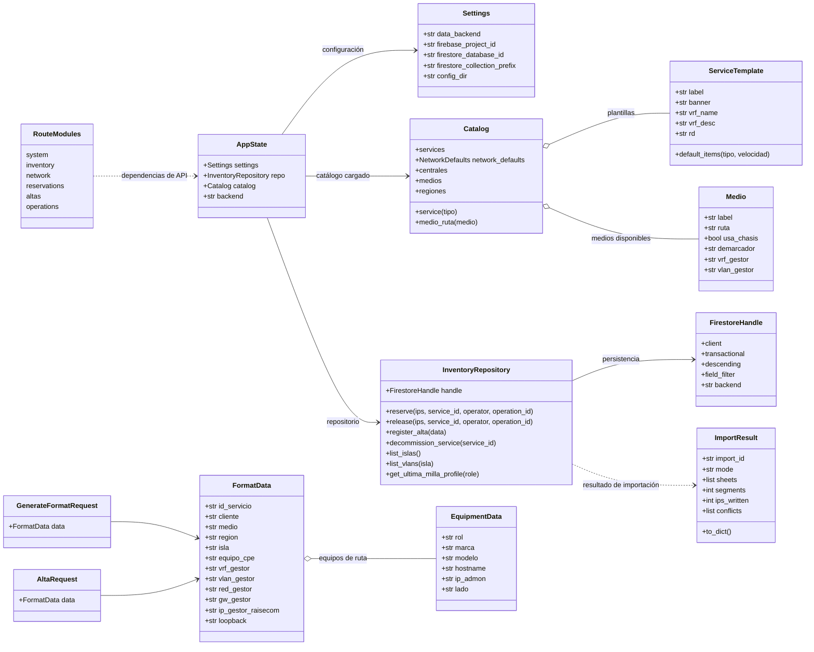
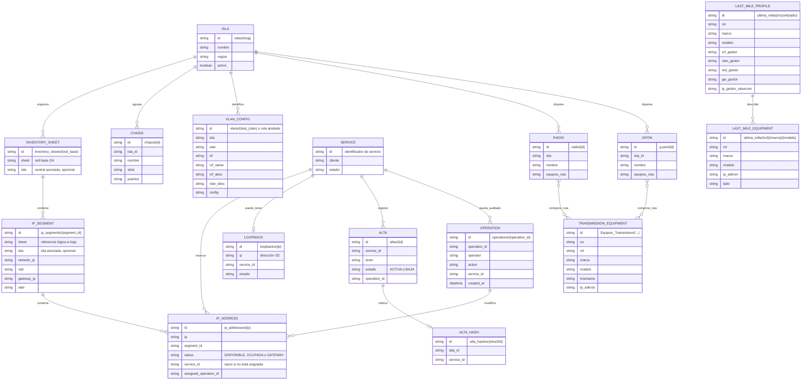

# Arquitectura y modelo de datos

## Propósito

Claro CENAM Service Manager es una aplicación web interna para administrar inventario de direcciones IP, reservar y liberar direcciones por servicio, consultar la topología de transporte y generar formatos de alta para servicios de INTERNET y DATOS. Los datos se guardan en Cloud Firestore; para desarrollo y demostraciones se puede usar un cliente en memoria compatible.

Este documento resume la arquitectura actual del código y presenta dos vistas complementarias: un diagrama de clases de los componentes principales y un diagrama entidad-relación del dominio. Las relaciones del diagrama ER son relaciones lógicas entre documentos; Firestore no impone claves foráneas.

## Tecnologías y organización

- **Interfaz:** HTML, CSS y JavaScript nativo en `frontend/`; FastAPI sirve los archivos estáticos.
- **API:** Python, FastAPI y Pydantic. Los routers se organizan por dominio: sistema, inventario, red, reservas, altas y operaciones.
- **Lógica de aplicación:** servicios de catálogo, topología, importación/exportación Excel y generación de formatos.
- **Persistencia:** `InventoryRepository` centraliza las operaciones sobre Firestore. `FirestoreHandle` permite usar Firestore real o el cliente falso en memoria.
- **Trazabilidad:** las peticiones reciben un identificador `operation_id`; las escrituras registran el operador y los datos de auditoría.

## Diagrama de clases

El diagrama muestra las dependencias principales y los modelos de entrada que representan los datos enviados por la interfaz. Los routers son módulos con funciones de endpoint, por eso se representan como módulos y no como clases.

## Diagrama entidad-relación

El inventario de IP y los registros del servicio son el núcleo transaccional. La topología, los equipos y las VLAN complementan la información usada para construir el formato. Los nombres entre paréntesis señalan colecciones o rutas conocidas de Firestore.

### Lectura del modelo

- **Inventario:** una hoja `/24` agrupa subredes; cada subred contiene direcciones IP. La dirección guarda su estado y, si está ocupada, el identificador del servicio.
- **Servicio y alta:** `SERVICE` es una entidad lógica identificada por `service_id`, no una colección central independiente. Ese identificador enlaza reservas, loopback, altas y operaciones. El alta guarda el texto generado y su estado; el hash permite detectar duplicados.
- **Topología:** una isla/central organiza hojas, segmentos, chasis y equipos de acceso. Radio y G-PON pueden referenciar equipos de transmisión que forman la ruta impresa.
- **VLAN:** su configuración se asocia a isla y número de VLAN, y puede estar en la estructura plana o en la estructura anidada compatible con Firestore.
- **Última milla:** los perfiles de MC, ONT y Radio suministran valores de gestión por rol; los documentos de equipos contienen marca, modelo e IP de administración. El CPE/FW se cataloga por rol, marca y modelo.
- **Auditoría:** `operation_id` identifica una petición y permite relacionar sus cambios con el operador, el servicio y las direcciones afectadas.

## Flujo típico de generación y registro de un alta

1. La interfaz consulta catálogos de islas, medios, equipos, VLAN y direcciones disponibles.
2. El operador selecciona el servicio y completa los datos; la API valida la carga mediante modelos Pydantic.
3. La API combina la carga con plantillas y datos de topología para generar una vista previa del formato.
4. Al registrar el alta, el repositorio persiste el formato y aplica en una transacción las asignaciones relacionadas que correspondan, como loopback e IPs.
5. El middleware asigna `operation_id` y registra la auditoría. Los errores de API también conservan ese identificador para facilitar su rastreo.

## Referencias del código

- Entrada y montaje de la aplicación: `backend/main.py`.
- Estado y dependencias de FastAPI: `backend/api/dependencies.py`.
- Modelos de entrada: `backend/schemas/requests.py`.
- Acceso a datos y operaciones de dominio: `backend/repositories/inventory.py`.
- Catálogo y valores predeterminados: `backend/services/catalog.py` y `config/`.
- Generación del formato: `backend/services/format_generator.py`.
- Interfaz: `frontend/index.html`, `frontend/app.js` y `frontend/style.css`.
